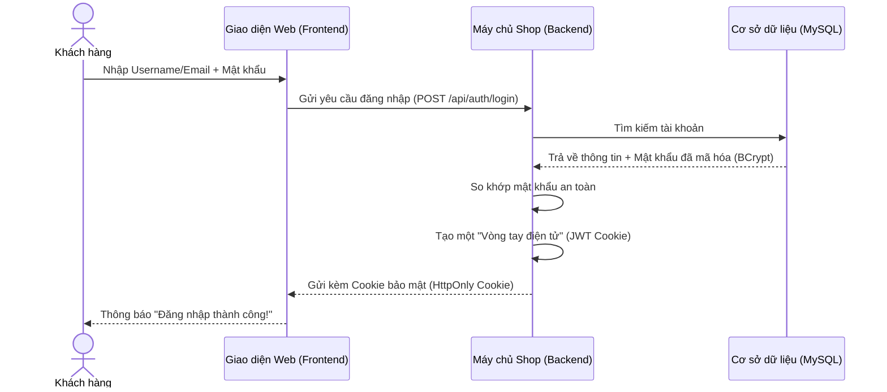

# 🔐 TÍNH NĂNG 1: ĐĂNG NHẬP & BẢO MẬT (AUTHENTICATION)

> **Góc nhìn khách hàng:** *"Tôi muốn có một tài khoản riêng để lưu lịch sử mua sắm, tích điểm và không phải gõ lại địa chỉ giao hàng mỗi khi mua áo."*

---

### 1. Phép so sánh đời thường dễ hiểu 💡
Hãy tưởng tượng trang web như một **khu trung tâm mua sắm cao cấp**:
* **Khách vãng lai:** Bạn chỉ đi dạo xem các mẫu áo trên giá trưng bày, xem giá bán và đọc đánh giá.
* **Đăng ký tài khoản (`Register`):** Giống như bạn đến quầy lễ tân làm một chiếc **Thẻ thành viên VIP**. Bạn cung cấp họ tên, số điện thoại, email và đặt mật khẩu bảo vệ.
* **Đăng nhập (`Login`):** Bạn xuất trình thẻ thành viên. Lễ tân kiểm tra đúng tên và mật khẩu, sau đó phát cho bạn một chiếc **Vòng tay thông minh (Token)**.
* **Lướt web mua sắm:** Từ lúc đeo vòng tay, bạn đi chọn áo, bỏ vào giỏ hàng, đặt hàng... bảo vệ và thu ngân chỉ cần quét vòng tay là biết ngay bạn là ai mà **không cần bắt bạn xuất trình lại chứng minh thư ở mỗi gian hàng**.
* **Đăng xuất (`Logout`):** Khi ra về, bạn tháo vòng tay trả lại. Phiên mua sắm kết thúc an toàn.

---

### 2. Cách hệ thống hoạt động bên dưới (Dưới nắp capo) ⚙️

---

### 3. Những điểm bảo mật thông minh của website 🛡️

1. **Mật khẩu không bao giờ lưu dưới dạng chữ thường:**
   - Nếu bạn đặt mật khẩu là `password123`, hệ thống không lưu nguyên chữ đó vào kho lưu trữ (vì nếu bị hack sẽ lộ).
   - Hệ thống dùng thuật toán **BCrypt** biến nó thành một dãy mã xáo trộn kỳ lạ: `$2a$10$8p0Vq/DhgaVKGzBgqtrUg...` Ngay cả người quản trị website cũng không thể đọc trộm mật khẩu của bạn.

2. **Công nghệ "Vòng tay vô hình" (HttpOnly Cookie):**
   - Vòng tay JWT được lưu trong một ngăn đặc biệt trên trình duyệt web của bạn.
   - Các đoạn mã độc hại hoặc virus máy tính trên trình duyệt **hoàn toàn không thể chạm tới hay lấy cắp được**, giúp tài khoản của bạn luôn an toàn 100%.

3. **Phân quyền rõ ràng (Role-based):**
   - **Khách hàng (`USER`):** Xem hàng, bình luận, thêm vào giỏ, đặt đơn và chat với shop.
   - **Nhân viên (`STAFF`):** Được duyệt đơn hàng, chuẩn bị gói hàng, trả lời tin nhắn của khách.
   - **Chủ cửa hàng (`ADMIN`):** Quản lý toàn bộ hệ thống, chỉnh sửa sản phẩm, xem báo cáo doanh thu và tiền lời.

---

### 4. Khách hàng sử dụng tính năng này như thế nào? 📱
1. Nhấp vào nút **Login / Register** ở góc trên cùng bên phải màn hình.
2. Nếu chưa có tài khoản: Nhập Tên, Email, Mật khẩu ➔ Nhấn **Đăng ký**.
3. Nếu đã có tài khoản: Điền Email/Username + Mật khẩu ➔ Nhấn **Đăng nhập**.
4. Website lập tức hiển thị tên và ảnh đại diện của bạn, giỏ hàng tự động được đồng bộ!

