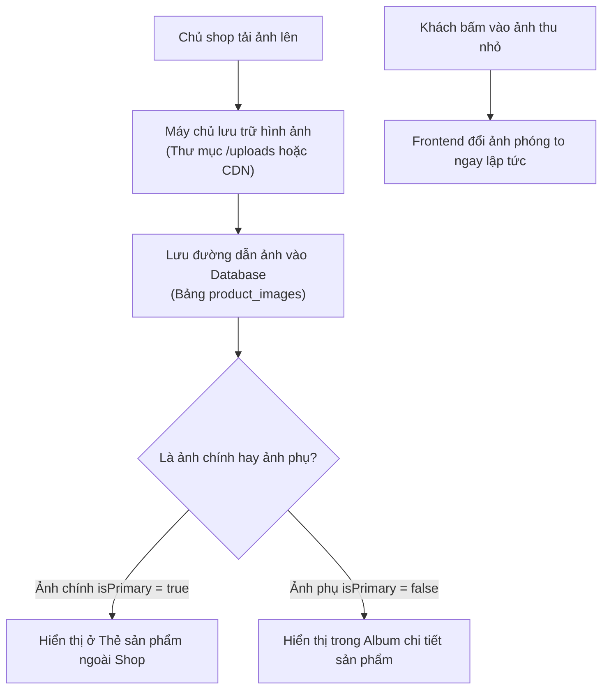

# 📸 TÍNH NĂNG 2: HÌNH ẢNH SẢN PHẨM (PRODUCT IMAGES)

> **Góc nhìn khách hàng:** *"Mua quần áo trên mạng điều tôi sợ nhất là ảnh một đằng hàng một nẻo. Tôi cần xem rõ ảnh chụp thật các góc: mặt trước, mặt sau và cận cảnh chất liệu vải."*

---

### 1. Phép so sánh đời thường dễ hiểu 💡
Hãy tưởng tượng khi bạn đi xem một cuốn **Catalogue thời trang**:
* **Ảnh bìa đại diện (`Ảnh chính - isPrimary`):** Là tấm ảnh đẹp nhất của chiếc áo được người mẫu mặc, dùng để trưng bày ngoài trang chủ và trang danh mục để bạn lướt xem nhanh.
* **Tập ảnh chi tiết bên trong (`Gallery`):** Khi bạn bấm vào chiếc áo đó, bạn được lật từng trang ảnh:
  - Trang 1: Mặt trước của áo.
  - Trang 2: Mặt sau của áo.
  - Trang 3: Chụp cận cảnh logo thêu, đường chỉ may và chất liệu vải cotton.
  - Trang 4: Người mẫu mặc khi phối với quần jean hoặc áo khoác.
* **Bấm vào ảnh con để đổi ảnh to:** Bạn đưa tay trỏ vào bức ảnh nhỏ nào, bức ảnh đó lập tức được chiếu to lên màn hình chính để bạn nhìn rõ nhất.

---

### 2. Cách hệ thống hoạt động bên dưới (Dưới nắp capo) ⚙️

---

### 3. Cấu trúc lưu trữ thông minh của website 🗄️

Trong hệ thống, một chiếc áo (`Product`) không chỉ có 1 tấm ảnh đơn điệu mà có cả một danh sách ảnh:
* **Mỗi bức ảnh có các thông tin:**
  - `imageUrl`: Đường link dẫn tới file ảnh sắc nét.
  - `isPrimary`: Đánh dấu `true` nếu đây là ảnh đại diện ngoài trang chủ.
  - `product_id`: Cho biết ảnh này thuộc về mẫu áo nào.

#### Tối ưu trải nghiệm cho khách mua hàng:
1. **Tải ảnh mượt mà, không bị lag:** Ảnh được tối ưu dung lượng và hỗ trợ tải lười (`lazy loading`), khi khách cuộn màn hình tới đâu thì ảnh ở đó mới tải, giúp tiết kiệm dung lượng 4G/Wifi cho khách.
2. **Ảnh tương ứng với màu sắc:** Khi khách chọn màu Đỏ, hệ thống có thể chuyển sang xem đúng ảnh mẫu áo màu Đỏ; chọn màu Đen xem mẫu áo màu Đen.

---

### 4. Khách hàng sử dụng tính năng này như thế nào? 📱
1. Khi lướt ngoài **Trang chủ / Cửa hàng**: Khách thấy ngay ảnh chính bắt mắt, rõ nét của từng mẫu áo.
2. Khi nhấp vào xem **Chi tiết sản phẩm**:
   - Ở bên trái xuất hiện khung ảnh lớn chính giữa.
   - Bên dưới là hàng loạt ảnh thu nhỏ (mặt trước, mặt sau, cận cảnh vải).
   - Khách chỉ cần **di chuột hoặc bấm vào ảnh nhỏ**, ảnh lớn sẽ lập tức đổi sang góc chụp đó mà không cần tải lại cả trang web.

