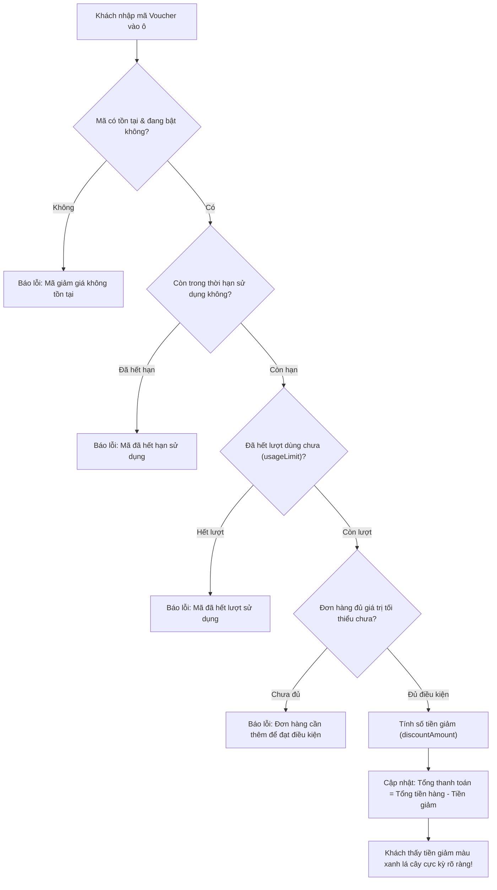

# 🎟️ TÍNH NĂNG 3: MÃ GIẢM GIÁ & KHUYẾN MÃI (VOUCHER)

> **Góc nhìn khách hàng:** *"Tôi thích săn mã giảm giá! Mỗi khi nhập mã `HE2026` hay `GIAM50K` vào giỏ hàng, nhìn thấy tổng tiền thanh toán được trừ đi một khoản là tôi cảm thấy mua sắm rất hời."*

---

### 1. Phép so sánh đời thường dễ hiểu 💡
Hãy tưởng tượng như khi bạn cầm **Phiếu giảm giá giấy tại siêu thị**:
* **Mã giảm giá (`Code`):** Là dòng chữ in trên phiếu, ví dụ `CHAOHAY2026` hoặc `SALE20`.
* **Điều kiện áp dụng:** Trên phiếu luôn có dòng chữ nhỏ:
  - *Áp dụng cho hóa đơn từ 300.000đ trở lên* (`minOrderValue`).
  - *Hạn sử dụng đến ngày 31/12/2026* (`startDate` - `endDate`).
  - *Chỉ có 100 phiếu phát ra, ai đến trước dùng trước* (`usageLimit`).
* **Tại quầy thu ngân:** Bạn đưa phiếu cho thu ngân. Máy tính quét mã:
  - Nếu đơn hàng của bạn mới 250.000đ ➔ Máy báo: *"Chưa đủ 300.000đ để áp dụng phiếu"*.
  - Nếu đơn hàng của bạn là 500.000đ ➔ Máy tính tự động trừ ngay số tiền giảm trực tiếp vào hóa đơn của bạn.

---

### 2. Cách hệ thống tính toán bên dưới (Dưới nắp capo) ⚙️

Hệ thống hỗ trợ 2 kiểu giảm giá thông minh:

| Kiểu giảm | Ví dụ | Cách tính |
| :--- | :--- | :--- |
| **Giảm theo phần trăm (`PERCENT`)** | Giảm 20% tối đa 100.000đ | Đơn 400.000đ ➔ Giảm `400k * 20% = 80.000đ`. Đơn 800.000đ ➔ 20% là 160k nhưng chạm trần `maxDiscount` 100k nên chỉ giảm đúng 100.000đ. |
| **Giảm tiền cố định (`FIXED_AMOUNT`)** | Giảm thẳng 50.000đ | Bất kể đơn hàng bao nhiêu (miễn là trên mức tối thiểu), hệ thống trừ ngay 50.000đ. |

---

### 3. Đảm bảo công bằng và chống gian lận 🔒
* **Trừ lượt sử dụng tức thì:** Khi đơn hàng hoàn tất, hệ thống tự động trừ `usageLimit` đi 1 để tránh trường hợp mã bị dùng vượt quá số lượng dự kiến của shop.
* **Tự động khôi phục nếu hủy đơn:** Nếu khách hàng quyết định hủy đơn hàng chưa xử lý, lượt dùng voucher sẽ được hoàn trả lại để khách có thể mua lại lần khác.

---

### 4. Khách hàng sử dụng tính năng này như thế nào? 📱
1. Khách chọn các mẫu áo ưng ý bỏ vào **Giỏ hàng (`Cart`)** hoặc bấm **Thanh toán (`Checkout`)**.
2. Tại màn hình tóm tắt đơn hàng, khách nhìn thấy ô nhập: `Nhập mã giảm giá...`.
3. Khách nhập mã (Ví dụ: `SALE10`) rồi bấm nút **Áp dụng**.
4. Website hiển thị ngay:
   - *Tạm tính:* `500.000 đ`
   - *Giảm giá (Voucher SALE10):* `- 50.000 đ`
   - *Tổng thanh toán:* **`450.000 đ`**
5. Khách an tâm bấm **Đặt hàng** với mức giá đã được giảm tốt nhất!

