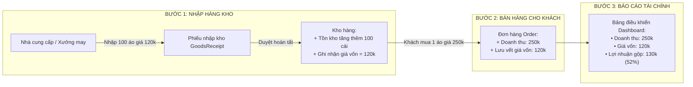

# 💰 TÍNH NĂNG 4: DOANH THU & LỢI NHUẬN THỰC TẾ (TOTAL REVENUE & PROFIT)

> **Góc nhìn quản lý shop:** *"Bán được 100 triệu tiền áo không có nghĩa là tôi lãi 100 triệu! Tôi phải trừ đi tiền nhập vải, tiền công xưởng may thì số tiền còn lại mới là lợi nhuận thực tế tôi đút vào túi."*

---

### 1. Phép so sánh đời thường dễ hiểu 💡
Hãy tưởng tượng **Cuốn sổ tính tiền của chủ tiệm quần áo**:
* **Doanh thu (`Total Revenue`):** Bạn bán 1 chiếc áo thun với giá `250.000đ`. Khách thanh toán cho bạn `250.000đ`. Đây là Doanh thu (tổng tiền khách đưa).
* **Giá vốn hàng bán (`COGS - Cost of Goods Sold`):** Chiếc áo thun này tháng trước bạn đặt xưởng may với giá sỉ là `120.000đ/cái`.
* **Lợi nhuận gộp thực tế (`Gross Profit`):** 
  $$\text{Lợi nhuận} = 250.000đ - 120.000đ = \mathbf{130.000đ}$$
  Đây mới chính là số tiền lãi thực sự của tiệm!
* **Tỷ suất lợi nhuận (`Profit Margin`):** Lãi 130k trên doanh thu 250k $\approx \mathbf{52\%}$. Nghĩa là cứ bán được 100 đồng tiền hàng thì tiệm thu về 52 đồng tiền lãi.

> ❌ **Sai lầm của đồ án sinh viên:** Chỉ cộng tổng tiền các đơn hàng lại và gọi đó là "lợi nhuận", không quan tâm hàng nhập giá bao nhiêu, dẫn đến báo cáo kinh doanh bị ảo!
> 
> ✅ **Hệ thống thực tế của QLShop:** Phân tách rạch ròi giữa Doanh thu, Chi phí vốn và Tiền lãi ròng!

---

### 2. Cách hệ thống tự động hóa từ Nhập hàng tới Bán hàng ⚙️

Hệ thống hoạt động khép kín theo chu trình 2 bước:

---

### 3. Ý nghĩa các chỉ số trên màn hình Dashboard 📊

Khi Chủ shop hoặc Quản lý truy cập vào trang thống kê, màn hình hiển thị:

1. **Tổng doanh thu (`totalRevenue`):**
   - Chỉ tính những đơn hàng **đã giao thành công (`COMPLETED`)**.
   - Đã trừ đi số tiền khách được giảm từ voucher.
2. **Tổng giá vốn (`totalCost`):**
   - Tổng số tiền gốc bạn đã bỏ ra để may/nhập toàn bộ số áo đã bán được.
3. **Tổng lợi nhuận thực tế (`totalProfit`):**
   - `totalRevenue - totalCost`: Con số thực tế nói lên shop đang ăn nên làm ra như thế nào.
4. **Tỷ suất lợi nhuận (`profitMargin`):**
   - Giúp bạn biết dòng sản phẩm nào mang lại biên độ lãi cao nhất để nhập thêm.
5. **Tổng tiền nhập kho (`totalImportExpense`):**
   - Tổng dòng vốn bạn đã chi trả cho các nhà cung cấp để chuẩn bị hàng hóa sẵn trong kho.

---

### 4. Tại sao giá nhập thay đổi mà hệ thống vẫn tính đúng? 🎯
Ví dụ:
- Tháng 1, bạn nhập lô áo giá vốn `100.000đ/cái`. Khách mua đợt này ➔ Hệ thống lưu giá vốn là `100.000đ`.
- Tháng 6, do vải tăng giá, bạn nhập lô mới giá vốn `130.000đ/cái`. Khách mua đợt sau ➔ Hệ thống lưu giá vốn là `130.000đ`.

Nhờ cơ chế lưu **`costPrice` trực tiếp vào từng đơn hàng tại thời điểm bán**, báo cáo doanh thu và lợi nhuận của tháng 1 và tháng 6 vẫn chính xác tuyệt đối, không hề bị sai lệch theo thời gian!

