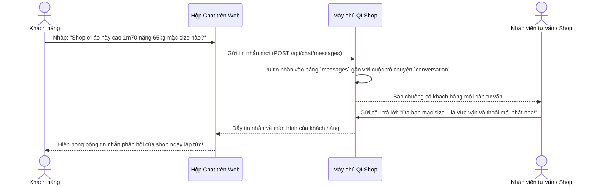

# 💬 TÍNH NĂNG 5: TRÒ CHUYỆN TRỰC TUYẾN (LIVE CHAT)

> **Góc nhìn khách hàng:** *"Tôi cao 1m72, nặng 65kg, tôi không biết mẫu áo thun oversize này nên mặc size M hay L thì đẹp? Tôi muốn nhắn tin hỏi shop ngay để được tư vấn trước khi bấm đặt hàng."*

---

### 1. Phép so sánh đời thường dễ hiểu 💡
Hãy tưởng tượng khi bạn bước vào một **cửa hàng quần áo ngoài đời thực**:
* **Khung chat:** Giống như **Nhân viên tư vấn đứng ngay cửa đón bạn**. Bất cứ khi nào bạn băn khoăn về size áo, màu vải hay thời gian ship hàng, bạn chỉ cần quay sang hỏi: *"Bạn ơi cho mình hỏi..."*.
* **Cuộc trò chuyện (`Conversation`):** Là chiếc bàn tiếp khách riêng biệt giữa **bạn** và **cửa hàng**. Toàn bộ lịch sử trao đổi của bạn từ hôm qua, tuần trước vẫn được lưu giữ nguyên vẹn.
* **Từng tin nhắn (`Message`):** Lời thoại qua lại. Có mốc thời gian rõ ràng (ví dụ: *10:15 AM*), trạng thái tin nhắn đã gửi và thông báo khi nhân viên đã xem.

---

### 2. Cách hệ thống hoạt động bên dưới (Dưới nắp capo) ⚙️

---

### 3. Cấu trúc lưu trữ dữ liệu khoa học 🗄️

Hệ thống quản lý tin nhắn thông qua 2 thực thể cốt lõi:

1. **Cuộc hội thoại (`Conversation`):**
   - Đóng vai trò là "chiếc hộp" lưu toàn bộ tin nhắn giữa một Khách hàng cụ thể và Shop.
   - Giúp nhân viên shop dễ dàng nhìn thấy danh sách: Khách A đang hỏi, Khách B đang cần tư vấn, Khách C hỏi về đơn hàng bị trễ.
2. **Chi tiết tin nhắn (`Message`):**
   - `sender`: Ai là người nói? (Khách hay Nhân viên).
   - `content`: Nội dung tin nhắn văn bản.
   - `createdAt`: Thời gian gửi (phút, giờ, ngày).
   - `isRead`: Đã xem hay chưa (giúp khách biết shop đã đọc tin nhắn của mình chưa).

---

### 4. Lợi ích vượt trội cho cả Khách hàng & Cửa hàng 🌟

| Lợi ích đối với Khách hàng | Lợi ích đối với Chủ shop |
| :--- | :--- |
| **Không cần rời website:** Tư vấn trực tiếp ngay khi đang xem sản phẩm, không cần mở Zalo hay Facebook. | **Tăng tỷ lệ chốt đơn (Conversion Rate):** Khách được giải đáp thắc mắc về size sẽ ra quyết định mua ngay. |
| **Xem lại lịch sử tư vấn:** Lần sau ghé lại vẫn nhớ shop từng khuyên mình mặc size gì. | **Giảm tỷ lệ đổi trả hàng:** Khách chọn đúng size nhờ tư vấn thì không lo bị chật hay rộng. |
| **Hỗ trợ đơn hàng:** Có thể hỏi trực tiếp: *"Đơn hàng #123 của em giao đến đâu rồi shop?"*. | **Chăm sóc khách hàng chuyên nghiệp:** Tạo sự tin cậy và gắn kết lâu dài với khách hàng. |

---

### 5. Khách hàng sử dụng tính năng này như thế nào? 📱
1. Khách bấm vào **biểu tượng bong bóng chat tròn** ở góc dưới cùng bên phải màn hình.
2. Một cửa sổ trò chuyện nhỏ xinh xắn sẽ mở lên.
3. Khách gõ nội dung câu hỏi và nhấn phím **Enter** hoặc nút **Gửi**.
4. Khi nhân viên shop phản hồi, tin nhắn sẽ hiện ra ngay lập tức kèm âm thanh thông báo nhẹ nhàng!

